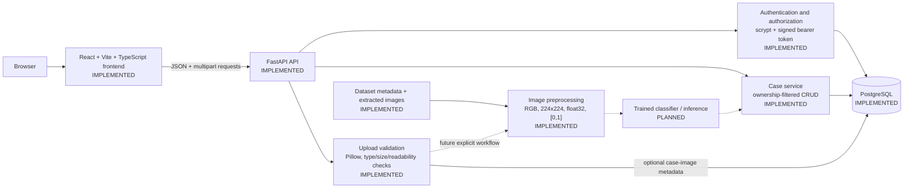

# DermAI System Architecture

## Status convention

- **IMPLEMENTED:** present in the inspected source code and/or verified database.
- **PARTIALLY IMPLEMENTED:** a foundation exists, but a documented or production-complete capability is missing.
- **PLANNED:** intentionally reserved for a later milestone.
- **NOT IMPLEMENTED:** no supporting implementation was found.

## Architecture diagram



The diagram shows actual request/data flows with solid arrows. Dashed arrows identify future or explicitly invoked extension points, not current upload behavior.

## Component responsibilities

### Browser frontend — IMPLEMENTED

The `frontend/` application provides login, registration, dashboard, case list, case creation/editing, case details, and image-upload screens. It uses `VITE_API_BASE_URL` for the backend origin and stores only the returned access token in browser storage.

### FastAPI API — IMPLEMENTED

`backend/app/main.py` exposes:

- `GET /`
- `GET /health`
- `GET /health/database`
- `POST /auth/register`
- `POST /auth/login`
- `POST /images/upload`
- `POST /images/upload?case_id={id}`
- `POST /cases`
- `GET /cases`
- `GET /cases/{case_id}`
- `PATCH /cases/{case_id}`
- `DELETE /cases/{case_id}`
- `GET /predictions/history`

### Authentication and authorization — IMPLEMENTED

`backend/app/auth.py` hashes passwords with scrypt. Login returns a signed bearer token. Protected case endpoints use `get_current_user`, which validates the signature and resolves the username against the `users` table. Case operations use the resolved database user ID rather than accepting a user ID from the frontend.

### Case service — IMPLEMENTED

`backend/app/cases.py` initializes and uses `cases` and `case_images`. Case queries include the authenticated `user_id`, so a user cannot read or mutate another user's case. Allowed statuses are `open`, `in_progress`, and `closed`.

### Upload validation — IMPLEMENTED

`backend/app/uploads.py` accepts JPG, JPEG, and PNG uploads, enforces a 10 MB limit, and verifies readability with Pillow. It returns image metadata. The current implementation does not persist image bytes.

### Preprocessing — IMPLEMENTED

`ai/image_preprocessing.py` checks the input path, converts to RGB, resizes to 224 × 224 by default, converts to `float32`, and normalizes pixels to `[0, 1]`. The upload endpoint does not automatically invoke this function.

### Dataset artifacts — IMPLEMENTED

`data/Skin_Metadata.csv` contains the original metadata. `data/prepared_metadata.csv` records locally matched images. `data/DATASET_0` contains the locally extracted image subset. `ai/prepare_dataset.py` uses `Subject_ID` groups to generate existing train, validation, and test CSV files.

### Future model inference — PLANNED

No model-training code, classifier, or inference endpoint is part of this milestone. The architecture reserves this component for a later, separately validated workflow.

## Database entity relationships

The inspected PostgreSQL database contains:

```text
users
  id BIGSERIAL PRIMARY KEY
  username VARCHAR(50) UNIQUE NOT NULL
  password_hash TEXT NOT NULL
  created_at TIMESTAMPTZ NOT NULL

cases
  id BIGSERIAL PRIMARY KEY
  user_id BIGINT NOT NULL REFERENCES users(id) ON DELETE CASCADE
  title VARCHAR(120) NOT NULL
  description TEXT
  status VARCHAR(20) CHECK (status IN ('open', 'in_progress', 'closed'))
  created_at TIMESTAMPTZ NOT NULL
  updated_at TIMESTAMPTZ NOT NULL

case_images
  id BIGSERIAL PRIMARY KEY
  case_id BIGINT NOT NULL REFERENCES cases(id) ON DELETE CASCADE
  filename VARCHAR(255) NOT NULL
  format VARCHAR(10) NOT NULL
  width INTEGER NOT NULL
  height INTEGER NOT NULL
  size_bytes INTEGER NOT NULL
  created_at TIMESTAMPTZ NOT NULL

prediction_history
  id BIGINT
  image_filename VARCHAR
  predicted_class VARCHAR
  confidence REAL
  created_at TIMESTAMPTZ
```

`prediction_history` remains separate from `cases`: a case is a user-managed record that can exist before any prediction, while prediction history records prediction-related fields.

## Security and authorization boundaries

- Password hashes, not plaintext passwords, are stored in PostgreSQL.
- `AUTH_SECRET` is read from the backend environment and is never sent to the frontend.
- Case endpoints require a verified bearer token.
- Case ownership is derived from the token-resolved user and enforced in SQL predicates.
- Case-image association verifies both case ID and authenticated user ID.
- SQL values are parameterized. The dynamic update field list is built only from Pydantic-controlled fields.
- CORS permits only the configured `FRONTEND_ORIGIN`, defaulting to the local Vite origin.

## Image-data flow

1. The browser selects an image and performs usability checks.
2. The browser submits multipart data with field name `file`.
3. FastAPI validates extension, content type, size, and image readability.
4. When `case_id` is supplied, only image metadata is inserted into `case_images` after ownership verification.
5. The image bytes are not currently persisted.
6. Preprocessing is available as a separate Python function and is not automatically triggered by upload.

## Configuration

Backend configuration is loaded from environment variables:

- `DB_HOST`
- `DB_PORT`
- `DB_NAME`
- `DB_USER`
- `DB_PASSWORD`
- `AUTH_SECRET`
- `FRONTEND_ORIGIN`

Frontend configuration uses `VITE_API_BASE_URL`. No secrets belong in Vite environment variables.

## Architectural decisions

- FastAPI and PostgreSQL are retained rather than replaced.
- Case management is separate from prediction history.
- Case-image associations store metadata rather than image binaries.
- Subject-grouped split generation reduces subject leakage risk.
- The future inference component is kept out of the current upload path.
- Idempotent `CREATE TABLE IF NOT EXISTS` initialization avoids destructive schema changes for this educational prototype.

## Current limitations and extension points

- Authentication tokens have no expiration claim.
- Image persistence/storage has not been implemented.
- Dataset licensing and source attribution require confirmation from authoritative dataset documentation.
- The target disease-class scope requires project-owner approval.
- Future model inference must define validation, uncertainty, and result-association behavior before being exposed through the API.
