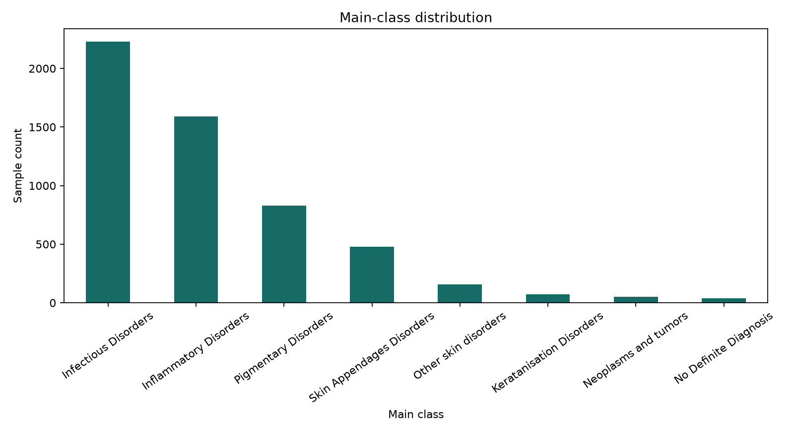
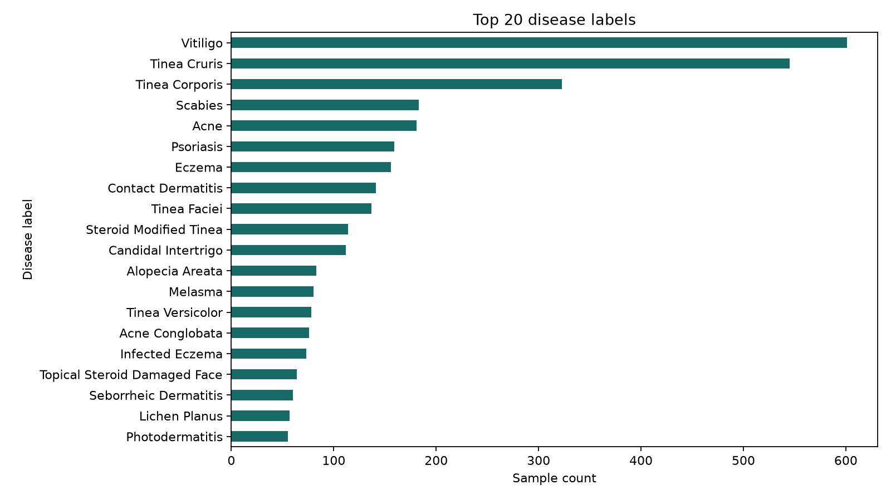
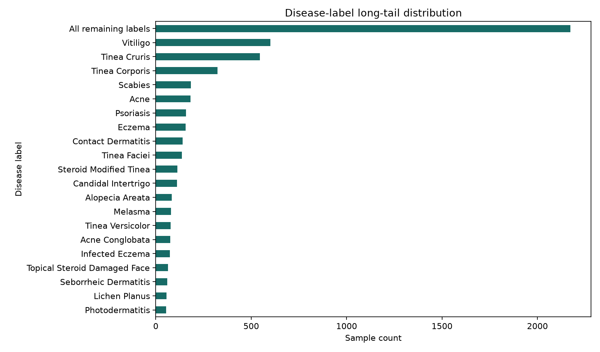
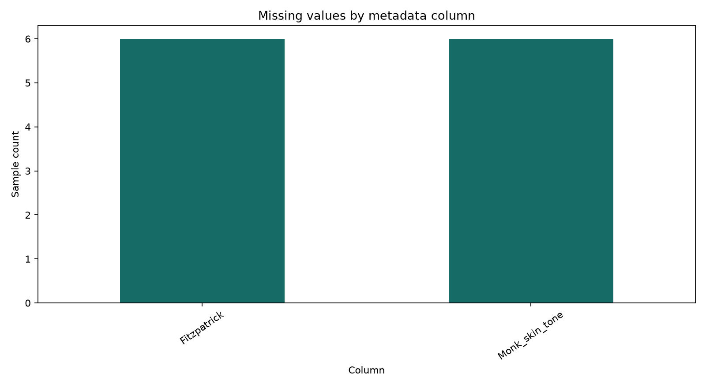
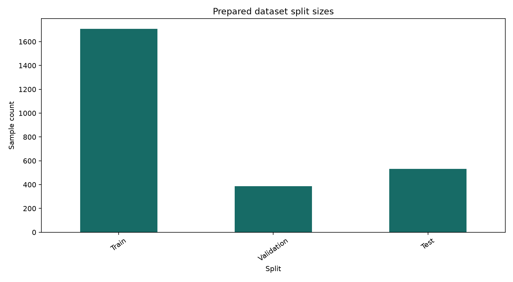

# DermAI Exploratory Data Analysis and Class Distribution Report

Generated: 2026-10-25

## Dataset source and attribution

The repository identifies the working dataset as DermaCon-IN through the project context and file names. No authoritative citation, license file, or source URL was present in the inspected repository, so licensing and de-identification claims are not independently verified here. The report therefore describes repository artifacts without asserting rights beyond the evidence available.

## Methodology

The reproducible script reads the original metadata, prepared metadata, extracted image directory, and existing train/validation/test CSV files. It recalculates counts, nulls, duplicates, filename matches, image readability, class distributions, subject overlap, image-record overlap, and generated split charts. Source files are never modified.

## Dataset overview

- Original metadata: **5,450 rows**, **14 columns**.
- Prepared metadata: **2,626 rows**, **15 columns**.
- Disease labels: **245**; main classes: **8**; subclasses: **19**.
- Unique subjects: **3,002**.
- Unique metadata image names: **5,450**; duplicate metadata rows: **0**; duplicate image names: **0**.

Important columns are `Image_name` (image identifier used for matching), `Disease_label` (fine-grained annotation), `Main_class` and `Sub_class` (broader annotation levels), and `Subject_ID` (subject grouping used by the split script). The analysis does not assume that each row is an independent subject because subject identifiers repeat.

### Metadata types and nulls

```text
Age                 str
Body_part           str
Descriptors         str
Confidence        int64
Disease_label       str
Fitzpatrick         str
Gradability         str
Image_name          str
Main_class          str
Monk_skin_tone      str
Quality             str
Sex                 str
Sub_class           str
Subject_ID          str
```

Null counts:

```text
Age               0
Body_part         0
Descriptors       0
Confidence        0
Disease_label     0
Fitzpatrick       6
Gradability       0
Image_name        0
Main_class        0
Monk_skin_tone    6
Quality           0
Sex               0
Sub_class         0
Subject_ID        0
```

## Data-quality findings

- Extracted image files indexed: **2,626** across **2,626 unique basenames**.
- Metadata records with a matching extracted basename: **2,626**; unmatched records: **2,824**.
- Extracted files with duplicate basenames: **0 additional file(s)**.
- Readability checks: **2,626 checked**, **0 unreadable**.
- Image formats: JPEG=2,615, PNG=11.
- Readable image width range: 380–4032 pixels; height range: 363–4032 pixels.
- Empty/whitespace disease labels: **0**; labels containing the Unicode replacement character: **1**.
- Unmatched metadata records may reflect an unextracted archive or incomplete local extraction; they are not treated as proof that source images are permanently missing.

## Class distribution

Main-class statistics: `{'classes': 8, 'minimum': 37, 'maximum': 2227, 'mean': 681.25, 'median': 319.5, 'rares_under_5': 0, 'rares_under_10': 0, 'least': ['No Definite Diagnosis'], 'most': ['Infectious Disorders'], 'imbalance_ratio': 60.189189189189186}`.

| Main_class | Count | Percentage |
|---|---:|---:|
| Infectious Disorders | 2227 | 40.86% |
| Inflammatory Disorders | 1592 | 29.21% |
| Pigmentary Disorders | 831 | 15.25% |
| Skin Appendages Disorders | 480 | 8.81% |
| Other skin disorders | 159 | 2.92% |
| Keratanisation Disorders | 72 | 1.32% |
| Neoplasms and tumors | 52 | 0.95% |
| No Definite Diagnosis | 37 | 0.68% |

Disease-label statistics:

`{'classes': 245, 'minimum': 1, 'maximum': 601, 'mean': 22.244897959183675, 'median': 5.0, 'rares_under_5': 112, 'rares_under_10': 154, 'least': ['Infected Nodule', 'Tick bite', 'Xanthelasma Palpebrarum', 'Miliaria', 'Keratoderma with Secondary Infection', 'Cutaneous Anthrax', 'Nutritional Dermatitis', 'Eczemated Tinea', 'White piedra', 'Xanthoma', 'Morphea', 'Dermatofibroma', 'Becker nevus', 'Cutaneous larva migrans', 'Bullous Fixed Drug Eruption', 'Nevus sebaceous', 'Gutted Lichen Planus', 'Steatocystoma Multiplex', 'Pseudolymphoma', 'Pseudoepitheliomatous keratotic & micaceous balanitis', 'Pseudofolliculitis barbae', 'Inverse psoriasis', 'Mongolian spot', 'Kyrle���������s Disease', 'Hyperpigmentation disorder', 'Pseudo lymphoma', 'Infection of toe web', 'Purpuric Dermatoses', 'Chronic eczema with secondary infection', 'Pustular psoriasis', 'Cellulitis', 'Inflammatory Linear Verrucous Epidermal Nevus', 'Pemphigus foliaceus', 'Syringoma', 'Pigmented purpuric eruption', 'Nodular vasculitis', 'Mucus Cyst', 'Balanitis', "Bowen's Metastasis", 'Keratoacanthoma', 'Cyst', 'Ochronosis', 'Lichen simplex', 'Hyper Hydrosis', 'Perioral dermatitis', 'Erythrasma', 'Haemorrhoids', 'Kerion', 'Myxoid Cyst', 'Trophic Ulcer', 'SLE - Systemic lupus erythematosus-related syndrome'], 'most': ['Vitiligo'], 'imbalance_ratio': 601.0}`

| Disease_label | Count | Percentage |
|---|---:|---:|
| Vitiligo | 601 | 11.03% |
| Tinea Cruris | 545 | 10.00% |
| Tinea Corporis | 323 | 5.93% |
| Scabies | 183 | 3.36% |
| Acne | 181 | 3.32% |
| Psoriasis | 159 | 2.92% |
| Eczema | 156 | 2.86% |
| Contact Dermatitis | 141 | 2.59% |
| Tinea Faciei | 137 | 2.51% |
| Steroid Modified Tinea | 114 | 2.09% |
| Candidal Intertrigo | 112 | 2.06% |
| Alopecia Areata | 83 | 1.52% |

Subclass statistics:

`{'classes': 19, 'minimum': 11, 'maximum': 1513, 'mean': 286.8421052631579, 'median': 128.0, 'rares_under_5': 0, 'rares_under_10': 0, 'least': ['Infectious skin conditions -Leprosy'], 'most': ['Infectious skin conditions -Fungal'], 'imbalance_ratio': 137.54545454545453}`

| Sub_class | Count | Percentage |
|---|---:|---:|
| Infectious skin conditions -Fungal | 1513 | 27.76% |
| Pigmentary Disorders | 831 | 15.25% |
| Inflammatory skin diseases (Eczema and Dermatitis) | 727 | 13.34% |
| Inflammatory skin diseases (Other) | 447 | 8.20% |
| Inflammatory skin diseases (Psoriasis and Lichenoid disorders) | 418 | 7.67% |
| Sebacious Glands and Acneiform Disorders | 352 | 6.46% |
| Infectious skin conditions -Parasitic | 241 | 4.42% |
| Infectious skin conditions -Bacterial | 176 | 3.23% |
| Other skin disorders | 159 | 2.92% |
| Hair Disorders | 128 | 2.35% |
| Infectious skin conditions -Viral | 107 | 1.96% |
| Inflammatory skin diseases + Infectious skin conditions -Bacterial | 104 | 1.91% |
| Keratanisation Disorders | 72 | 1.32% |
| Neoplasms and tumors | 52 | 0.95% |
| No Definite Diagnosis | 37 | 0.68% |
| Infectious skin conditions -Parasitic +  Infectious skin conditions -Bacterial | 36 | 0.66% |
| Infectious skin conditions -Fungal + Infectious skin conditions -Bacterial | 26 | 0.48% |
| Inflammatory skin diseases + Infectious skin conditions -Fungal | 13 | 0.24% |
| Infectious skin conditions -Leprosy | 11 | 0.20% |

The disease-label median is much smaller than the maximum, indicating a long tail. Labels below 5 samples are treated as very rare for this report; labels below 10 are treated as low-support. These thresholds are reporting conventions, not clinical or modeling requirements.



*Figure 1. Counts and relative scale of the broad main classes.*



*Figure 2. The 20 most frequent fine-grained disease labels.*



*Figure 3. Top disease labels compared with the aggregate remaining long tail.*



*Figure 4. Missing metadata values; zero bars are omitted when no column is missing.*

## Prepared dataset and split analysis

- **Train:** 1,708 rows; 896 unique subjects; 156 disease labels; missing image references: 0.
  - Main-class counts: Infectious Disorders: 715, Inflammatory Disorders: 444, Pigmentary Disorders: 231, Skin Appendages Disorders: 196, Other skin disorders: 63, Neoplasms and tumors: 22, Keratanisation Disorders: 22, No Definite Diagnosis: 15.
- **Validation:** 386 rows; 207 unique subjects; 85 disease labels; missing image references: 0.
  - Main-class counts: Infectious Disorders: 148, Inflammatory Disorders: 147, Pigmentary Disorders: 45, Skin Appendages Disorders: 19, Other skin disorders: 10, No Definite Diagnosis: 7, Neoplasms and tumors: 5, Keratanisation Disorders: 5.
- **Test:** 532 rows; 276 unique subjects; 94 disease labels; missing image references: 0.
  - Main-class counts: Infectious Disorders: 218, Inflammatory Disorders: 153, Pigmentary Disorders: 69, Skin Appendages Disorders: 64, Other skin disorders: 15, Neoplasms and tumors: 5, Keratanisation Disorders: 4, No Definite Diagnosis: 4.

Subject overlap checks: `{'Train/Validation': 0, 'Train/Test': 0, 'Validation/Test': 0}`.
Image-record overlap checks: `{'Train/Validation': 0, 'Train/Test': 0, 'Validation/Test': 0}`.

The existing split-generation script uses `GroupShuffleSplit` on `Subject_ID` and asserts disjoint subject sets. This report independently checks subject and available image-reference overlap; it does not claim that all possible forms of leakage have been eliminated.



*Figure 5. Row counts in the existing prepared splits.*

## Target-class recommendation

For an educational first classifier, the **8 `Main_class` categories** are the most defensible candidate level because they provide broader support than the 245 fine-grained disease labels. This remains a recommendation, not a finalized implementation decision.

- Main-class support ranges from 37 to 2,227 records, with an imbalance ratio of 60.19:1.
- Fine-grained disease-label support ranges from 1 to 601; 112 labels have fewer than 5 records and 154 have fewer than 10.
- A selected subset of disease labels could be considered only after project-owner approval, explicit clinical/educational rationale, and a minimum-support rule.
- All labels remain candidates in the source data; this task does not modify or discard any labels.

## Key findings and limitations

- The local extracted working set is smaller than the original metadata, so matching results depend on the extraction state.
- Subject identifiers repeat and are therefore important for evaluating split independence.
- The metadata contains six null values in `Fitzpatrick` and six in `Monk_skin_tone`; other inspected required fields have no nulls.
- The repository does not contain authoritative dataset citation/license evidence, so attribution and reuse terms require confirmation before external distribution.
- Upload validation and preprocessing are implemented, but no model training or inference is included in this milestone.

## Reproduction

From any working directory, run:

```powershell
.\.venv\Scripts\python.exe ai\generate_eda_report.py
```

The script writes this report and figures under `reports/` and exits non-zero when required inputs or critical analysis steps fail.
